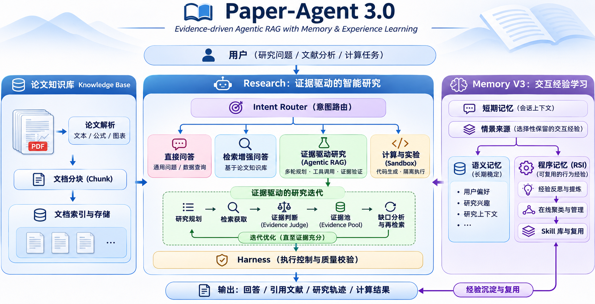

# Paper-Agent 3.0

Paper-Agent 是一个论文阅读助手。上传 PDF 后，你可以用中文追问实验细节、比较两篇论文的方法，再沿着引用核对原文。它也能记住你的研究兴趣和讲解偏好，在下次对话中继续使用。



## 快速开始

准备 **64 位 Windows、Python 3.11 和 Git**。以下命令在 PowerShell 中运行。

**1. 获取项目。** 先克隆源码，再按需要选择模型。

```powershell
$env:GIT_LFS_SKIP_SMUDGE = '1'
git clone https://github.com/Zhenghao9103/Paper-Agent.git
Remove-Item Env:GIT_LFS_SKIP_SMUDGE
cd Paper-Agent
```

**2. 选择一种安装方式。** 两种方式都在本地解析和检索论文。

| 问题路由 | 安装命令 | 需要准备 |
| --- | --- | --- |
| 本地（默认） | `.\setup.ps1` | Git LFS，首次安装会下载约 1.1 GB 的路由模型 |
| Jev 云端 | `.\setup.ps1 -RouterProvider jev` | Jev API 密钥，安装后填入 `.env` 的 `JEV_API_KEY` |

**3. 配置回答模型并启动。** 在项目根目录的 `.env` 中填写模型服务商提供的 API 地址、密钥和模型名。支持 OpenAI 兼容接口。

```dotenv
AGENT_BASE_URL=https://your-provider.example/v1
AGENT_API_KEY=your_api_key
AGENT_MODEL=your_model
```

启动后，浏览器会打开[聊天页](http://127.0.0.1:8000)。

```powershell
.\.venv\Scripts\python.exe main.py
```

上传一篇 PDF，等文档状态显示 `indexed` 后，试着问：

> 这篇论文最重要的结论是什么？哪组实验支持它？请标出原文出处。
