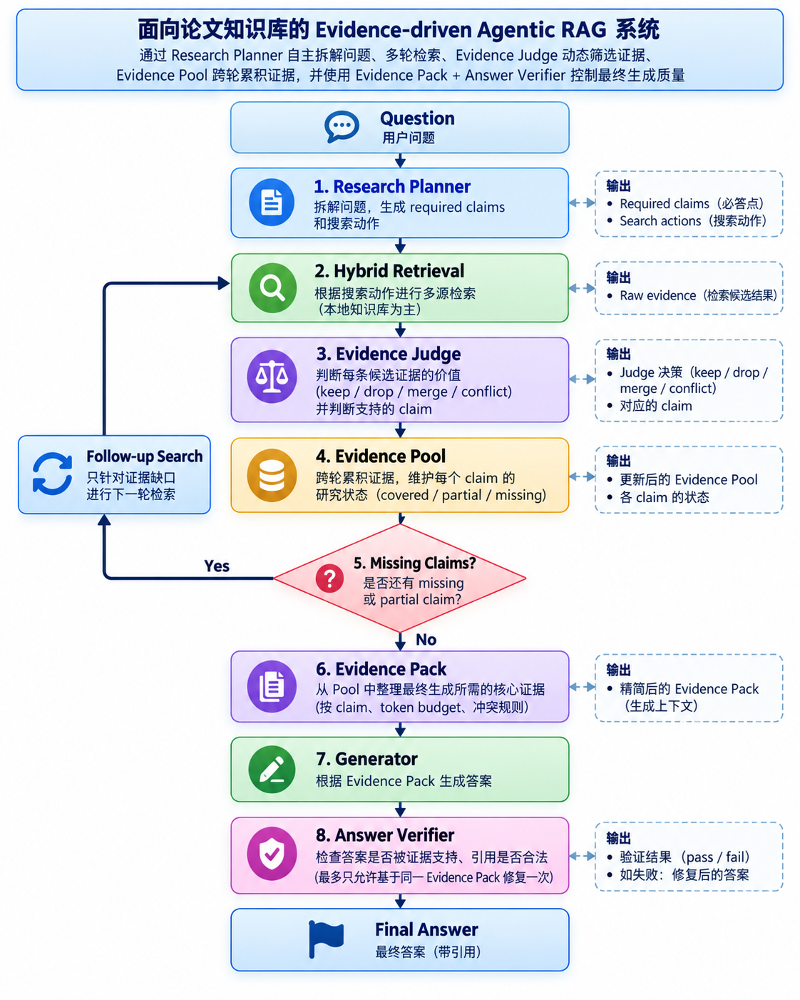

# Paper-Agent 3.0.0

Paper-Agent 是一个面向学术 PDF 的本地优先研究助手。上传论文后，可以追问某个实验、比较两篇论文的方法，并沿回答中的引用回到原文核对。默认的 **Research** 模式负责阅读与问答；需要运行 Python 或生成图表时，可以启用 **Compute**。

3.0 扩展了跨会话记忆。除了记住“我主要研究多视图聚类”这样的研究兴趣，助手还可以从“以后先举例，再给定义”这样的纠正中学到回答步骤。新会话遇到相似问题时，RSI 会检索适用的策略。

## 在 Windows 上运行

完整安装需要 **64 位 Windows、Python 3.11、Git 和至少 20 GB 可用空间**。请在本地磁盘运行 PowerShell，确认 `python --version` 显示 3.11。首次安装需要联网下载解析和检索模型。默认的本地 Router 还需要 Git LFS。

**1. 克隆仓库并安装。** 先跳过克隆时的模型下载，再由安装器按选定的 Router 拉取所需文件。

```powershell
$env:GIT_LFS_SKIP_SMUDGE = '1'
git clone https://github.com/Zhenghao9103/Paper-Agent.git
Remove-Item Env:GIT_LFS_SKIP_SMUDGE
cd Paper-Agent
git lfs install
.\setup.ps1
```

如果使用 **Jev 云端路由**，克隆后直接运行 `.\setup.ps1 -RouterProvider jev` 即可跳过 Git LFS、约 1.1 GB 的本地 Qwen Router 和 llama.cpp。两种安装方式都会准备 MinerU、BGE-M3 和 BGE-Reranker。各项资源的版本见 [资源锁定清单](resources.lock.json)。

**2. 配置回答模型。** 安装完成后，编辑项目根目录的 `.env`，填入支持 OpenAI 兼容接口的模型服务。Router 只负责选择问答路径，两种路由方式都需要配置回答模型。

```dotenv
AGENT_BASE_URL=https://your-provider.example/v1
AGENT_API_KEY=your_api_key
AGENT_MODEL=your_model
```

选择 Jev 时，在同一文件中填写 `JEV_API_KEY`。使用自定义服务地址或模型时，同时设置 `JEV_BASE_URL` 和 `JEV_MODEL`。如果配置后仍连到了旧模型，检查 `backend/.env` 是否也设置了同名模型参数，该文件中的值优先。

**3. 启动并试问一篇论文。**

```powershell
.\.venv\Scripts\python.exe main.py
```

浏览器会打开 [本地聊天页](http://127.0.0.1:8000)。上传一篇 PDF，等文档状态变为 `indexed`，再问“这篇论文用哪些数据集做了对比实验？请指出原文依据”。服务版本可以在 [健康检查](http://127.0.0.1:8000/api/health) 查看。若希望自行打开浏览器，启动前设置 `$env:PAPER_AGENT_OPEN_BROWSER = '0'`。

## Research 如何回答

MinerU 解析论文，SQLite 保存结构化内容。检索时，BM25 匹配术语，BGE-M3 和 Chroma 召回语义相关片段，BGE-Reranker 对候选片段重排。Router 根据问题和当前会话选择执行路径。

| 问题示例 | 路径 | 实际行为 |
| --- | --- | --- |
| “我上传了几篇论文？” | `direct` | 查本地文档记录。普通概念问答也走这条路径，由回答模型生成。 |
| “这篇论文的消融实验用了哪些指标？” | `simple_rag` | 规划查询，执行一轮混合检索和重排，再根据证据回答。 |
| “比较两篇论文的实验设置，哪些差异会影响结论？” | `agentic_rag` | 将问题拆成需要核对的要点，围绕证据缺口继续检索，再生成并校验答案。 |

默认研究循环最多 3 轮、5 次工具调用，总时限为 180 秒。论文中的数值、方法和结论由检索证据支撑，用户记忆用于调整上下文和讲解方式。



## Memory V3 如何从对话中学习

| 记忆 | 在 Paper-Agent 中的作用 | 例子 |
| --- | --- | --- |
| 情景记忆 | 按需关联支撑记忆写入的消息、反馈或会话检查点。普通寒暄无需额外建一条长期情景记录。 | 保留用户在哪次讲解后要求改变解释顺序。 |
| 语义记忆 | 跨会话复用用户偏好、研究兴趣、研究上下文和待办事项。 | 用户说“记住，我主要研究多视图聚类”，后续可以据此给出阅读建议。 |
| 程序记忆 | 从明确反馈或有可核验结果的交互中提炼带适用条件和步骤的策略，称为 Skill。 | 下次解释数学概念时，先给一个数字例子，再给定义。 |

同一本地实例的会话共享策略库。普通问答默认通过 **RSI** 先选最多 3 个相关簇，再从中选最多 4 条有效策略。聊天追踪中的 `procedural_memory` 记录实际传入回答模型的 Skill ID 和版本。一次反馈能否形成策略取决于反思与判断结果。

在 `backend/.env` 中设置 `PROCEDURAL_MEMORY_MODE`，重启后生效。默认值为 `rsi`，已有部署的显式设置优先。

| 模式 | 行为 |
| --- | --- |
| `rsi` | 写入策略，按簇检索并注入相关策略 |
| `flat` | 写入策略，在全部有效策略中按相似度检索 |
| `write` | 提炼并写入策略，回答时跳过策略召回 |
| `off` | 关闭程序记忆，继续使用原有语义记忆 |

Paper-Agent 内置了与[独立 RSI 模块](https://github.com/Zhenghao9103/RSI/tree/75432f62e92d71b4e5acb7c63cbe8093fd649344)同源的实现，直接使用应用的会话、模型配置和数据库。

## 从 2.2 升级

1. 停止后端，备份当前使用的 SQLite 数据库和 Chroma 目录。默认位置为 `backend/data/papermind.db` 和 `chroma/`。
2. 更新到 3.0 源码后，在项目根目录、使用原部署的数据库配置运行迁移。

   ```powershell
   .\.venv\Scripts\python.exe -m alembic -c backend/alembic.ini upgrade head
   ```

3. 如果旧配置显式设置过 `APP_VERSION`，更新为 `3.0.0`。重启后检查 `/api/health`，再用一个已有的研究兴趣验证跨会话召回。迁移会增加程序记忆与聚类索引表，继续使用原有语义记忆。

## 可选的 Sandbox Compute

标准安装即可使用 Research。需要执行计算时，先准备 Docker Desktop 的 Linux 容器引擎，在项目根目录运行：

```powershell
.\.venv\Scripts\python.exe -m pip install -r backend/requirements-sandbox.txt
.\.venv\Scripts\python.exe -m venv .tools/sandbox-venv
.\.tools\sandbox-venv\Scripts\python.exe -m pip install './sandbox_runtime[mcp]'
docker build -t paper-agent-sandbox:0.1.0 sandbox_runtime/images/python
$env:SANDBOX_ENABLED = 'true'
$env:SANDBOX_PYTHON_EXECUTABLE = (Resolve-Path '.tools/sandbox-venv/Scripts/python.exe').Path
```

从同一 PowerShell 启动或重启 Paper-Agent，在聊天页选择 **Compute**，试问“计算 [1, 2, 3, 4] 的均值并画折线图”。预期可以看到均值 `2.5` 和可下载的图表。环境变量也可写入 `backend/.env` 以便下次启动时使用。执行环境和产物说明见 [Sandbox Runtime](sandbox_runtime/README.md)。

## 开发与评测

- [后端配置示例](backend/.env.example)列出了路由、模型、检索、记忆和 Sandbox 的配置项。
- [程序记忆测试](tests/procedural_memory)覆盖跨会话使用、来源追溯、索引恢复和数据库升级。安装测试工具后，在项目根目录运行 `python -m pytest tests/procedural_memory -q`。
- [Memory V3 开发评测](eval/memory/RESULTS.md)记录了关闭程序记忆、仅写入、平面检索和 RSI 四组对照的逐项结果与局限。
- [Router 评测](eval/router/README.md)和 [RAG 评测](eval/rag/)提供路由分类、检索和回答质量的复现实验入口。

[MIT 许可证](LICENSE)
