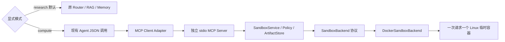

# Sandbox Runtime

独立、可替换 Backend 的本地 Python 执行组件。Runtime 不导入 Paper-Agent；
MCP 封装和应用接入均为可选功能。当前只有 Docker Backend。



## 安装与独立运行

以下为项目根目录下的 PowerShell 命令。只需要 Python 3.11，不需要安装 Paper-Agent。
也可以把本目录单独复制到另一位置再安装。

```powershell
python -m venv .tools/sandbox-venv
& .tools/sandbox-venv/Scripts/python.exe -m pip install -e './sandbox_runtime[mcp]'
```

不需要 MCP 时只安装 `./sandbox_runtime`。固定依赖为 `docker==7.2.0`、
`pydantic==2.13.4`；MCP extra 使用官方 `mcp==2.3.0` 的 `MCPServer`。
MCP v1/FastMCP 不兼容本实现。

先准备 Docker Desktop **Linux containers**，然后显式构建镜像：

```powershell
docker info --format '{{.OSType}}'
docker build -t paper-agent-sandbox:0.1.0 sandbox_runtime/images/python
& .tools/sandbox-venv/Scripts/python.exe -m sandbox_runtime.cli sandbox_runtime/examples/execute_mean.py
& .tools/sandbox-venv/Scripts/python.exe -m sandbox_runtime.cli sandbox_runtime/examples/create_chart.py
```

基础镜像固定 Python 3.11.15 和 registry manifest digest。镜像预装 NumPy 1.26.4、Pandas 2.2.3、Matplotlib 3.9.4。
构建需要网络；执行时不拉镜像、不安装包。镜像缺失返回 `image_unavailable`。

Python 接口：

```python
from sandbox_runtime import ExecutePythonRequest, SandboxService
from sandbox_runtime.backends.docker import DockerSandboxBackend

service = SandboxService(DockerSandboxBackend())
try:
    result = service.execute(
        ExecutePythonRequest(
            code="import json, numpy as np\n"
            "with open('/workspace/inputs.json') as f: data = json.load(f)\n"
            "print(float(np.mean(data['values'])))",
            inputs={"values": [1, 2, 3, 4]},
        )
    )
    print(result.model_dump_json(indent=2))
finally:
    service.close()
```

`execution_id` 由服务端生成。状态为 `success`、`execution_error`、`timed_out`、
`rejected` 或 `infra_error`。返回独立的 stdout/stderr、退出码、实际耗时、截断标志及产物元信息。
OOM、取消等通过 `error_category` 区分；退出 137 本身不作为 OOM 依据。
独立的 `cleanup_status`、`cleanup_error_category`、`cleanup_duration_ms` 记录回收结果，
清理失败不覆盖原执行结果。旧会话省略这些字段时使用默认值。
MCP 将执行失败或清理失败标为 `isError`；CLI 对上述情况返回非零退出码。

## 执行与存储限制

| 项目 | 默认值或行为 |
| --- | --- |
| 资源 | 1 vCPU、1 GiB RAM（禁额外 swap）、64 PIDs |
| 时限 | 30 秒整体执行 deadline；SDK 请求受剩余时间限制，清理另有短暂宽限 |
| 文件系统 | 根目录只读，`/workspace` 64 MiB tmpfs、`/tmp` 32 MiB tmpfs |
| 权限 | UID/GID 10001、无网络、无 capabilities、no-new-privileges、无 privileged |
| 输入 | 代码 64 KiB、JSON 256 KiB、最大深度 16；禁止 pickle/宿主文件导入 |
| 输出 | stdout/stderr 各 64 KiB；超限返回 `execution_error/output_limit` |
| 产物 | 最多 5 个，单个 10 MiB，合计 25 MiB；仅顶层 PNG/CSV/JSON |
| 本地存储 | 24 小时 TTL，256 MiB 配额，数据及元数据各至少计入 4 KiB |

资源参数只能由服务端 `SandboxPolicy` 或可信启动参数设置，不由工具调用者提升。
输入以分块 Base64 数据参数交给固定 runner（避免 Linux 单参数大小限制），
固定 runner 在容器 tmpfs 写出代码与 JSON，然后使用固定 argv
`python -I -B /workspace/main.py`。容器 keeper 保持 tmpfs 存活，固定 `collect.py`
通过 exec 流返回归档，再删除整个容器。Docker archive API 无法正确访问此 tmpfs，故不使用。

执行和归档流均有监督机制；取消请求会设置取消事件并尝试移除对应容器。
清理失败保留引用和租约供 shutdown 重试。Phase 6 按规范化产物目录派生稳定 owner，
以实例 ID 和 execution ID 标记容器；启动扫描及每次执行前先获得同一 store 的 OS 租约。
获得租约后可回收该 owner 上一实例的新鲜残留，其他 owner 和活跃租约受到保护。
旧版缺少 owner/instance 标签的容器不自动删除，需要人工确认归属。

同一 store 同时只允许一个执行实例，竞争调用明确返回 `runtime_busy`，不提供排队调度。
不同 store 可独立并发；该 OS 锁只协调同一宿主机，不提供分布式所有权管理。
容器 PID 1 的 monotonic watchdog 寿命为服务端 deadline 加 5 秒，Runtime 被强杀时
仍会停止整个容器；停止后的 Docker 元数据由下次恢复删除。
daemon 完全不可访问时无法保证立即删除；恢复后重试，清理未完成时拒绝新任务。

执行用户代码前必须通过 daemon 内置 seccomp、容器 inspect 和固定进程探针检查；
缺少任何隔离条件即返回 `isolation_unavailable`，不静默放宽限制。

归档不会使用 `extractall`；拒绝绝对路径、穿越、软/硬链接、设备、FIFO、稀疏文件、
嵌套输出及不允许的类型。PNG 检查签名；CSV/JSON 检查 UTF-8，JSON 还检查可解析性。
不在宿主解码图像或执行文件内容。产物用随机 ID 保存，客户端不获得宿主绝对路径。

默认存储位于当前用户的 `LOCALAPPDATA/paper-agent-sandbox/artifacts`
（非 Windows 使用用户数据目录）。多 stdio 服务通过操作系统文件锁共享该存储的配额。
TTL 清理在保存/读取等操作时执行；需要空闲时回收，可由本地计划任务调用：

```python
from sandbox_runtime.artifacts import ArtifactStore, default_artifact_root
from sandbox_runtime.policy import SandboxPolicy

ArtifactStore(default_artifact_root(), SandboxPolicy()).cleanup()
```

这是可信本机宿主上的 Docker 隔离，不提供公网多租户服务或容器逃逸防护保证。
不挂载宿主目录、Docker Socket、凭据或数据库；不将宿主环境自动传入执行容器。

## 独立 MCP 与 Inspector

```powershell
& .tools/sandbox-venv/Scripts/python.exe -m sandbox_runtime.mcp_server
# 启动后 stdout 专供 MCP；没有交互式命令提示符。
& .tools/sandbox-venv/Scripts/python.exe sandbox_runtime/examples/mcp_client.py
```

对支持 stdio 的 MCP 客户端使用以下配置；`command` 请替换为实际的绝对路径：

```json
{
  "mcpServers": {
    "sandbox": {
      "command": "D:/Paper-Agent/.tools/sandbox-venv/Scripts/python.exe",
      "args": ["-m", "sandbox_runtime.mcp_server"]
    }
  }
}
```

工具只有：

- `execute_python(code, inputs=None)`：返回带 Schema 的执行结果；失败设置 MCP `isError`。
- `get_artifact(artifact_id)`：只读，返回 `info` 和 `data_base64`。选择 Tool 方式便于不同客户端读取 PNG/CSV/JSON，不依赖客户端 Resource 展示能力。

独立客户端与服务使用同一 SDK 版本。原生 stdio 客户端退出时服务有 shutdown 清理；
协议日志仅写 stderr，代码 stdout/stderr 属于结构化工具结果。

独立 stdio 客户端必须受信任；opaque artifact ID 是读取能力凭证，不提供多用户认证。
应用 HTTP 接口另外重查对应会话的成功执行记录及元信息，再经 Adapter 读取。

有 Node/npm 后，可按 [官方 Inspector](https://github.com/modelcontextprotocol/inspector) 启动：

```powershell
npx --yes @modelcontextprotocol/inspector ./.tools/sandbox-venv/Scripts/python.exe -m sandbox_runtime.mcp_server
```

在 Inspector 中依次验证 Tools List、NumPy 均值、Matplotlib 文件生成、
`get_artifact` 读取和错误代码调用。v2 CLI 的服务命令使用 `--` 分隔：

```powershell
npx --yes @modelcontextprotocol/inspector --cli --method tools/list --format json -- ./.tools/sandbox-venv/Scripts/python.exe -m sandbox_runtime.mcp_server
```

## Paper-Agent 接入

运行时环境与后端环境分开。只在后端选择性安装 MCP Client：

```powershell
& .\.venv\Scripts\python.exe -m pip install -r backend/requirements-sandbox.txt
```

在后端环境变量或 `.env` 中设置：

```dotenv
SANDBOX_ENABLED=true
SANDBOX_PYTHON_EXECUTABLE=D:/Paper-Agent/.tools/sandbox-venv/Scripts/python.exe
SANDBOX_TIMEOUT_SECONDS=45
# 可选：服务端产物目录；省略时使用用户数据目录
# SANDBOX_ARTIFACT_STORE=D:/sandbox-artifacts
```

`SANDBOX_TIMEOUT_SECONDS` 是一次 MCP 通信总预算（10–120 秒）；Adapter 传递的容器
deadline 为 `min(30, 总预算 - 8)` 秒，给启动和取消清理留出时间。默认仍为 30 秒。
关闭功能或不安装 MCP/Docker 时，Research 不导入或连接这些 SDK。

聊天页明确选择 Research/Compute，默认 Research。普通 `/api/chat/ask` 与
`/api/chat/stream` 均接受 `mode`，历史请求省略它仍为 Research。

建议演示顺序：

1. Research：普通论文问题；即使文字中要求执行代码，也不调用 Sandbox。
2. Compute：输入“计算 1、2、3、4 的均值并画折线图”，查看真实输出及 PNG。
3. 同会话追问“使用刚才的数据改成柱状图”，确认执行 ID 不同、结构化输入一致。
4. 换一个会话请求原文件 ID，应被应用层拒绝。
5. 关闭 Sandbox，Research 继续工作；Compute 显示工具未启用或不可用。

Compute 使用现有 `agent_json`，最多一次可选本地检索和一次执行；不修改 Router，
不扩展研究 Planner 白名单，不增加 Task Builder、自动修复或宿主执行回退。
回答展示实际 stdout，论文输入引用单独列出。

执行上下文写到现有 TranscriptEvent 的 `sandbox_execution` 类型，按会话保留最新 20 条、
最多 7 天（写入计算记录时清理）；不扩展 ORM，不需要 Alembic 迁移。Compute 不写 ChatMessage，
因此其代码、输出和文件不会进入研究 checkpoint/Memory V2。后续复用从成功记录取原始
结构化输入，并重新创建容器。应用下载 URL 检查会话与产物的关联，不能用模型路径读取文件。
已有系统没有新增用户认证；会话检查不构成公网多用户认证体系。

## 故障排查

`infra_error`：先检查 Docker Desktop、Linux containers、镜像与 MCP 解释器。
`cleanup_failed`：恢复 daemon 后重新启动 MCP 服务，检查标签为
`paper-agent.sandbox-runtime=1` 的容器；不要删除无关容器。
`artifact_quota`：等待 TTL 或对独立产物存储执行清理；过期文件不能恢复下载。
`output_limit`：减少打印量；禁止依赖被截断的数值输出推断计算成功。
